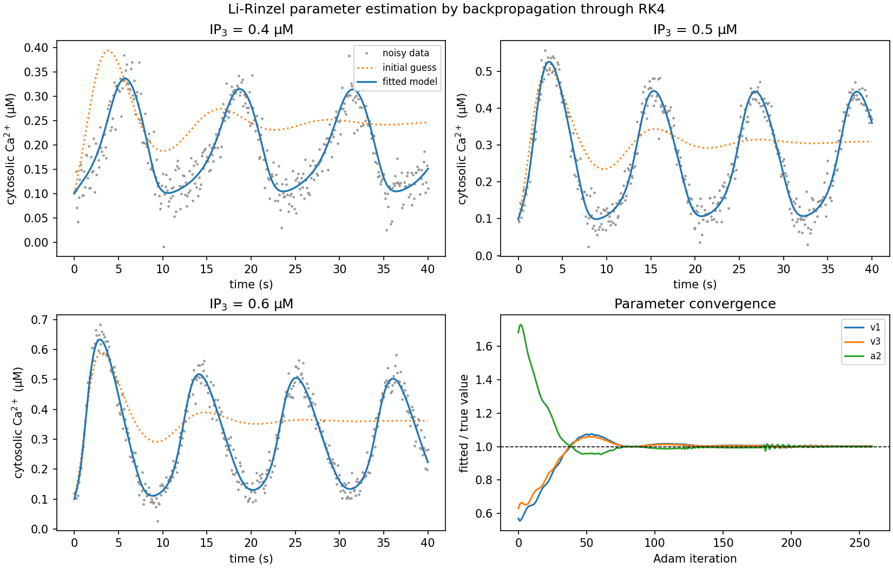
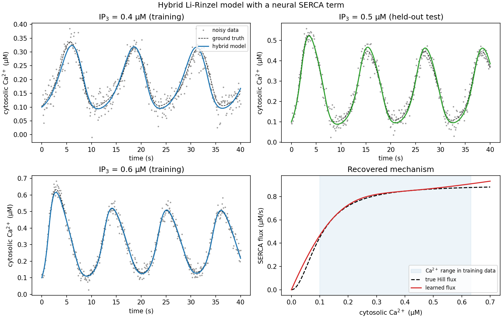

# Differentiable calcium dynamics in PyTorch

Mechanistic ODE models and neural networks, trained together by backpropagating through the ODE solver.

This is a small, self-contained project built on the Li-Rinzel model of IP₃-induced Ca²⁺ oscillations, the same receptor kinetics I used in my MSc thesis on intercellular calcium waves. It asks two questions:

1. **Parameter estimation.** If the model structure is known, can gradient descent through the simulator recover the kinetic parameters from noisy traces?
2. **Hybrid modelling.** If one term of the model is unknown and is replaced by a neural network, does the network learn the *mechanism* that generated the data, or only something that fits the traces?

All data are synthetic, so every answer can be checked against the ground truth.

## Model

Cytosolic Ca²⁺ `c` and the IP₃ receptor gating variable `h` follow the Li-Rinzel equations (Li & Rinzel, 1994):

```
dc/dt = J_IP3R(c, h, IP3) + J_leak(c) − J_SERCA(c)
dh/dt = α_h(IP3) (1 − h) − a2 · c · h
```

with `J_IP3R = c1 v1 m∞³ n∞³ h³ (c_ER − c)`, `J_SERCA = v3 c² / (k3² + c²)` and ER Ca²⁺ obtained from conservation. Parameters are the original Li-Rinzel values (`calcium/model.py`).

The solver is a fixed-step classical RK4 written with arithmetic operators only, so **the same code runs on NumPy arrays and PyTorch tensors**. With tensors, autograd differentiates through every solver step; no adjoint library is needed for a system this small. At `dt = 0.1 s` the RK4 error is below 10⁻⁶ µM against a tight-tolerance SciPy reference.

**Synthetic data:** three traces at IP₃ = 0.4, 0.5 and 0.6 µM, 40 s each, sampled at 10 Hz, with Gaussian noise (σ = 0.03 µM) (`calcium/data.py`).

## Part 1 · Parameter estimation through the solver

`fit_parameters.py` fits `v1` (IP₃R flux rate), `v3` (SERCA maximal rate) and `a2` (IP₃R inactivation rate). They start 40–60% away from the true values and are fitted with Adam on log-parameters, so they stay positive. The loss is the mean squared error to all three traces. The time window grows from 10 s to 40 s during training, a common safeguard against the phase-matching local minima of oscillatory systems.

All three parameters are recovered to well under 1%, and the final loss sits at the noise floor (σ² = 0.0009 µM²).



## Part 2 · A hybrid model with a neural SERCA term

`fit_hybrid.py` removes the SERCA Hill function and replaces it with a neural network (a universal differential equation). The learned flux is

```
J_SERCA(c) = c · softplus(MLP(c / 0.5))
```

so two physical constraints are built in: no pumping without cytosolic Ca²⁺, `J(0) = 0`, and no reverse flux, `J ≥ 0`. The rest of the model stays mechanistic.

The network (1 → 16 → 1, tanh, 49 parameters) is trained end-to-end through RK4 on the IP₃ = 0.4 and 0.6 µM traces only. IP₃ = 0.5 µM is held out.

- **Held-out trace:** predicted with an RMSE of about 0.01 µM against the noise-free truth, well below the measurement noise.
- **Recovered mechanism:** inside the Ca²⁺ range seen during training, the learned flux matches the true Hill function within a few percent.
- **Outside that range,** the data contain no information about the flux, and the network's extrapolation is not trustworthy. This is the shaded region in the bottom-right panel.



The point of Part 2 is the distinction between fitting and identifying. A network that only reproduced the training traces would not generalise to a new IP₃ level. Constraining it with the known structure of the model is what lets it recover the actual pump kinetics.

## Running it

Requires Python ≥ 3.9. Everything runs on CPU.

```bash
pip install -r requirements.txt
python -m pytest                # 4 checks, including an autograd gradcheck through RK4
python fit_parameters.py        # Part 1, a few minutes
python fit_hybrid.py            # Part 2, roughly 5–15 minutes
```

Add `--quick` to either script for a short smoke test. `--quick` does not train long enough to converge. Figures are written to `figures/`.

## Limitations

- Synthetic data and known initial conditions; real imaging data would add indicator kinetics, baseline drift and unknown `h(0)`.
- A closed single-cell model with constant IP₃. My thesis model adds IP₃ production, ATP signalling and intercellular coupling (PDE); its MATLAB/Python code is not part of this repository.
- Gradients come from direct backpropagation through a fixed-step solver. For stiff or larger systems, an adaptive implicit solver with adjoint sensitivities (e.g. `torchdiffeq`, `diffrax`) would be the next step.

## Repository layout

```
calcium/model.py     Li-Rinzel right-hand side and RK4 solver (NumPy / PyTorch)
calcium/data.py      synthetic dataset
fit_parameters.py    Part 1
fit_hybrid.py        Part 2
tests/               backend agreement, gradcheck, model constraints
```

## Reference

Li, Y.-X. & Rinzel, J. (1994). Equations for InsP₃ receptor-mediated [Ca²⁺]ᵢ oscillations derived from a detailed kinetic model: a Hodgkin-Huxley like formalism. *Journal of Theoretical Biology*, 166(4), 461–473.

---

Giorgia Gavioli · MIT License
